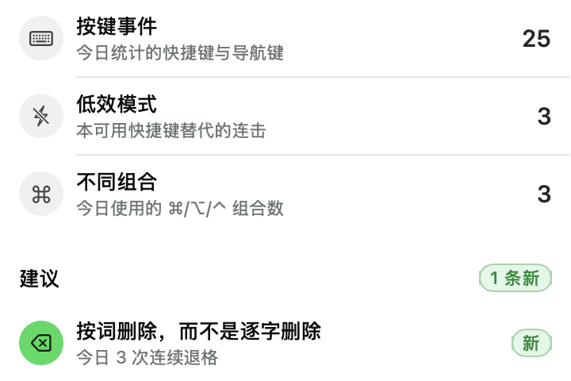
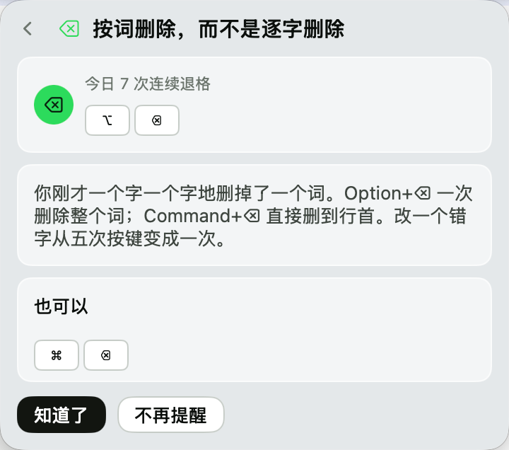
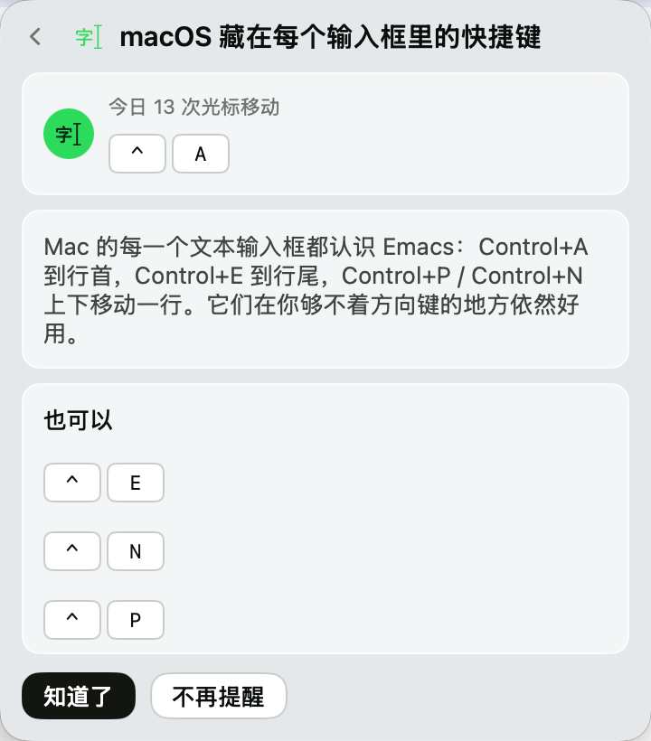
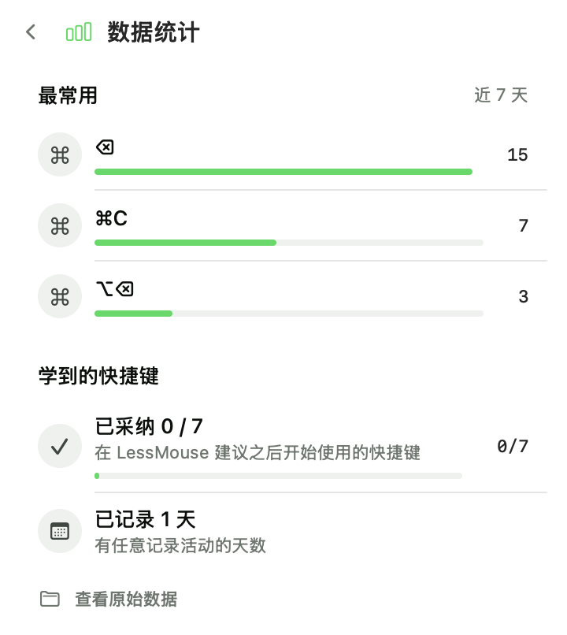
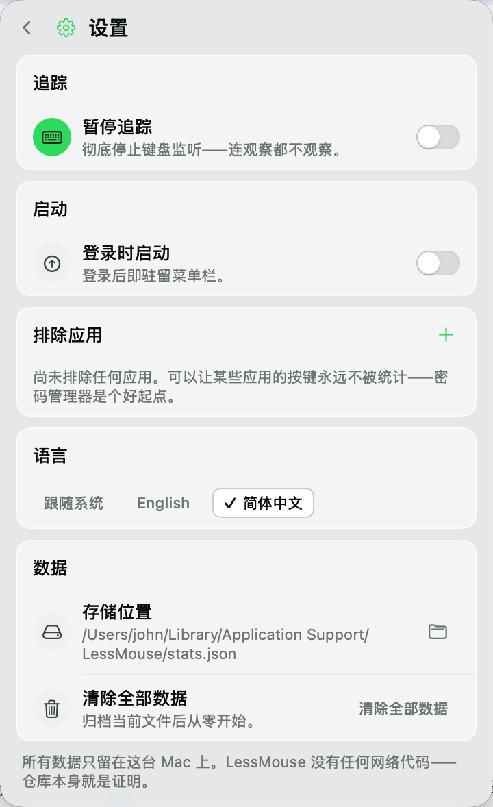

# LessMouse

> Your keyboard coach on the menu bar. It watches how you type, spots the
> slow habits — five backspaces to fix one word, twenty arrows to cross a
> paragraph — and shows you the shortcut that replaces them. It also notices
> when you reach for the mouse to pick a menu command that has a shortcut of
> its own. When you start using it, LessMouse notices, and celebrates.

**[简体中文文档](README.zh-CN.md)**



Born from the essay *《AI 时代，你更需要用好快捷键》* ("In the AI era, you need
keyboard shortcuts more than ever") — the argument that in an AI era the
handful of things you still do by hand deserve to be done fast. Reading about
shortcuts doesn't build habits; a coach that sees your actual habits does.

## How it works

1. LessMouse counts the keys you press — **only** shortcuts and navigation
   keys, as aggregate counts (see Privacy below).
2. When a slow pattern repeats enough in a day (say, three bursts of
   five-plus backspaces), a green dot appears on the menu bar ⌘ icon.
3. Click it: the card shows what was seen, what to press instead, drawn as
   keycaps — and more than one way in, because coaching isn't prescribing.
4. The next time you press the taught shortcut, the card flips to **adopted**
   and the banner says so. Progress lands on the stats page.

The mouse half works the same way. Every menu command you keep reaching for
with the mouse already has its shortcut printed beside it — LessMouse reads
the *shape* of a menu (where the item sits, what shortcut it prints, never
the words in it) and, once you've picked the same command three times in a
day, teaches you that shortcut. Press it, and the same adoption detection
fires.




## Features

- **Today's ledger** — key events counted, slow patterns detected, distinct
  shortcuts used, menu commands picked with the mouse, refreshed as you type.
- **A coaching inbox** — cards appear only when a habit is real (thresholds
  are "unmistakable", not "technically possible"); unread ones carry the
  green dot and a *new* pill.
- **A menu coach** — three mouse-clicks on a command that prints a shortcut,
  and you get a card for it. No list of apps, no list of menus: every app
  already knows its own shortcuts, and LessMouse asks the app. Off until you
  turn it on in settings.
- **Adoption detection** — press a taught shortcut after reading its card and
  the celebration banner fires, once, ever. The stats page tracks how many of
  the coached shortcuts you've taken up.
- **Stats** — most-used shortcuts over the last 7 days, adoption progress,
  days observed.
- **Pause tracking** — stops the keyboard listener *completely*: nothing is
  watched at all.
- **Excluded apps** — password managers, banking, anything you name; excluded
  apps aren't even observed.
- **Launch at login** — lives in the menu bar from the moment you log in.
- **English and 简体中文**, following the system language, switchable in
  settings.
- **Erase everything** — one two-tap action; the old data file is archived on
  disk first. History is kept to 60 days automatically.

 

## Privacy — the whole policy

**LessMouse never records what you type.** The event filter is ~20 lines with
a test that sweeps every keycode × modifier combination to keep it that way.
**It never records what your menus say either** — menu titles are the one
attribute the menu coach does not read, and its data type has no field for
them. The coach reads seven attributes per menu item (position, size, role,
enabled, and the shortcut's keycode, character and modifier mask); a title is
not among them, so a filename or an account name sitting in a menu has no path
into LessMouse.

What is counted, nothing else:

- **Shortcuts** — keystrokes with ⌘/⌥/⌃ held (`cmd+c`, `opt+backspace`)
- **Navigation keys** — backspace, arrows, Home/End, PageUp/Down, Esc, Tab, F-keys
- **Detected slow patterns** — "backspace-burst fired 4 times today"
- **Menu commands** — how many times today you picked, with the mouse, a
  command whose shortcut is ⌘S / ⌥⇧O / … (`menuCommands: { "cmd+s": 3 }`).
  Not the command's name, not where you clicked.

Three defenses deep:

| Defense | What it does |
|---|---|
| Signature filter | Bare letters and ⇧+letters are text — dropped before anything is kept. Held-key autorepeat never counts. |
| Secure input guard | While a password sheet has focus, LessMouse observes nothing at all. |
| Exclusions | Any app can be excluded entirely; excluded apps aren't even watched. |

The signature filter is the *same* filter the menu coach applies to every shortcut
it reads out of a menu: a gesture LessMouse would never count can't be taught,
so a card always names something a keypress can produce — and a bare letter
never reaches stats.json from either half.

All data lives in one human-readable file —
`~/Library/Application Support/LessMouse/stats.json` — opened from the stats
page or by hand, deleted from settings. The codebase has **zero network code
and zero third-party dependencies**; audit it, that's the point of open
source.

### Two permissions, and one of them is optional

| Permission | For | If you don't grant it |
|---|---|---|
| **Input Monitoring** | the keyboard half — everything in the original app | LessMouse shows its permission page and does nothing |
| **Accessibility** | the menu coach only | the coach stays dormant; the keyboard half works exactly as before |

LessMouse never asks for Accessibility on its own — it only checks whether
it's already granted, and if not, Settings shows one row explaining the coach
is asleep with a button that opens the pane. Nothing in the app prompts.

## Install

**From source** (no Apple Developer account needed anywhere):

```bash
git clone https://github.com/AGIHunt/lessmouse.git
cd LessMouse
scripts/make-app.sh     # builds, bundles, ad-hoc signs → dist/LessMouse.zip
```

Unzip, then **right-click LessMouse.app → Open** (twice on first launch) —
Gatekeeper's standard dance for unsigned-but-honest software. Drag it into
`/Applications` if it sticks.

**First run — Input Monitoring.** LessMouse asks for the **Input Monitoring**
permission (System Settings → Privacy & Security → Input Monitoring): a
listen-only keyboard tap is what counts patterns, and Input Monitoring is the
permission macOS requires for it — Accessibility alone is *not* enough. If
the app still says "needs permission" after granting, quit and reopen it
once; macOS caches tap refusals per launch. After installing a **new
download** (ad-hoc builds re-identify on every build), remove the old
LessMouse entry in Input Monitoring and add the new one. Maintainers signing
with a stable identity (`CODESIGN_IDENTITY=… scripts/make-app.sh`) don't
re-grant.

**Optional — Accessibility, for the menu coach only.** The coach reads menus
through the accessibility API, and LessMouse only ever *checks* that
permission — it never asks. It also ships off: grant Accessibility (System
Settings → Privacy & Security → Accessibility) *and* turn it on in Settings →
*Coach menu commands too*, and it wakes up; skip either and everything else
works exactly as before.

## Build & develop

```bash
swift build       # build
swift test        # 132 tests: privacy sweeps, detector, engine, menu coach, layout
swift run LessMouse  # run from CLI (see note)
```

macOS 14+, Swift 5.9+, zero dependencies. `swift run` works for development,
but TCC attributes the permission to your terminal — for the real experience
build the app (`scripts/make-app.sh`) and launch that. (Same for the menu
coach: `swift run` inherits your terminal's Accessibility grant, if it has
one.)

## The coaching book (v1)

The last row is the odd one: it isn't written down anywhere in the code. Every
app already knows its own shortcuts, so LessMouse asks the app — see
[docs/menu-coach.md](docs/menu-coach.md) for how, and what it costs.

| You keep… | LessMouse teaches |
|---|---|
| Burst-deleting letters | ⌥⌫ delete word · ⌘⌫ delete to line start |
| Crawling with ← → | ⌥←/⌥→ hop by word · ⌘←/⌘→ line start/end |
| Selecting char by char | ⌥⇧←/→ select by word · ⇧⌘→ select to line end |
| Scrolling documents | ⌘↑/⌘↓ document start/end |
| Using Home/End | ⌘←/⌘→ — the Mac way |
| Never touching ⌘` | switching windows of one app *(taught after days of multi-app work without it)* |
| Moving by arrow alone | ⌃A/⌃E/⌃P/⌃N — the Emacs keys every Mac text field knows |
| Switching apps by mouse | ⌘⇥ — when app switches are many but ⌘Tab's share of them is tiny |
| Switching browser tabs by mouse | ⌃⇥ / ⇧⌃⇥ — after days of browser use without them |
| Picking menu commands with the mouse | whatever the menu prints beside the command *(discovered at runtime — three clicks in a day, any app)* |

Cards cool down when read but not adopted (3–5 days), disappear forever when
dismissed, and celebrate exactly once when adopted.

## FAQ

**The menu bar icon isn't there.** If you use a menu bar manager (Bartender,
Ice, Vanilla…), new items often start hidden — set LessMouse to *Always
Shown* in its settings. On notched MacBooks, a crowded bar collapses items
into the hidden zone past the notch. LessMouse itself never removes its icon.

**I granted Accessibility and nothing happened.** For the keyboard half,
that's the wrong pane — the app needs **Input Monitoring** (see Install). The
permission page's button opens the right one. Accessibility is only for the
menu coach; without it the coach sleeps and Settings says so.

**Why is the menu coach asleep?** Two reasons, in order: it ships off — turn it on in Settings → *Coach menu commands too* first; and it needs Accessibility, which LessMouse checks but never asks for. To grant it: Settings → *Coach menu commands too* → *Open System Settings* → Privacy & Security → **Accessibility**, add LessMouse, and quit and reopen it once. The row disappears by itself the moment the grant lands.

**Why isn't my favourite menu command coached?** It has to print a shortcut
(Quit and Preferences don't), it has to be picked three times in a day, and
you have to not already be pressing that shortcut for two of those three. If
you open the menu by pressing and dragging, the release that picks the
command isn't seen — only mouse presses are. There's also a cap of three
menu cards per day, so the ones you click most come first. A greyed-out
command doesn't count either: it can't run, so clicking it used nothing.
Shortcuts on the space bar and Return aren't taught — those two keys aren't in
the table the keyboard half uses either. Nor are the ones you can only type
with ⌥ or ⌃ held (å, ¡…): a card has to name a key you can actually press.
Nor is anything carrying the globe key (🌐): Finder's 显示 › 进入全屏幕 is 🌐F
and 窗口 › 居中 is 🌐⌃C. Accessibility reports a modifier bit the SDK never
documents, and LessMouse's keyboard half never reads it — so pressing 🌐⌃C and
pressing ⌃C look identical to it, and a card for either could only be confirmed
by the wrong keypress. Those are left untaught on purpose.

**Why does `opt+a` show up in my stats?** On some layouts ⌥+letter types a
character (å, ∆…). LessMouse counts the *combination* ("opt+a: 3") — an
aggregate count, never the text around it. Exclude the app if you'd rather
not count it at all.

**Where is my data, and how do I nuke it?** One file:
`~/Library/Application Support/LessMouse/` (stats.json + suggestions.json,
both human-readable). Settings → *Erase all data* archives and resets them.

**Something looks wedged.** Quit and reopen LessMouse — the event tap is
re-built on every launch. Still stuck? File an issue with the app version
(Settings → storage path shows the build).

## Contributing

PRs welcome — including the **Windows port**, which the architecture was
shaped for (see [CONTRIBUTING.md](CONTRIBUTING.md)).

## License

MIT — see [LICENSE](LICENSE).
